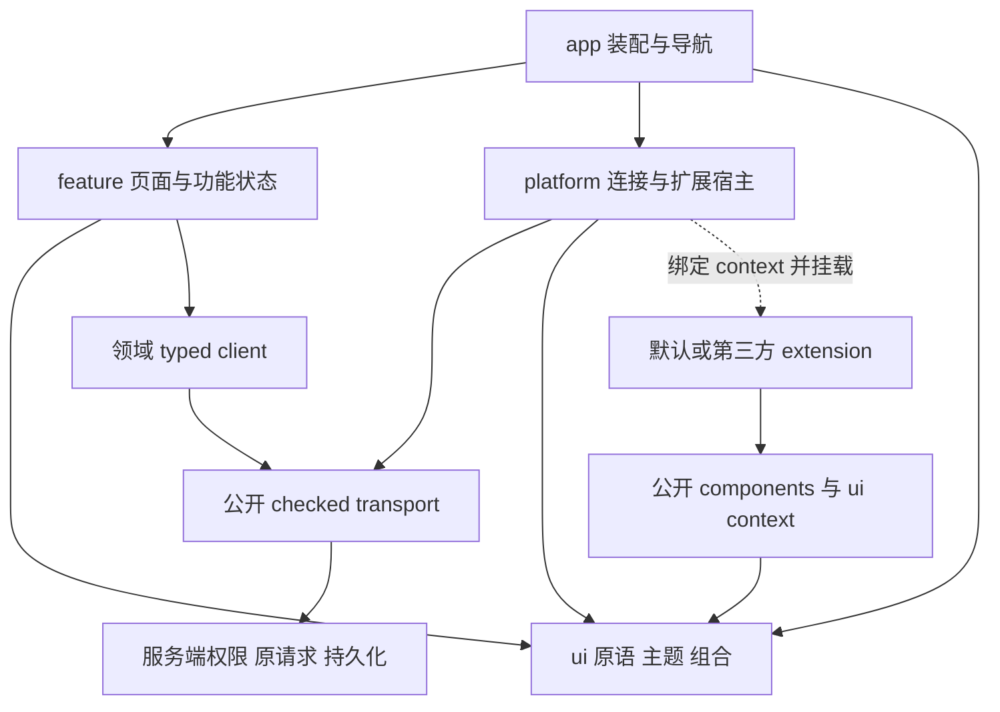

# WebUI 文件结构、职责与接口

先读[开发原则](FRONTEND-GUIDELINES.md)。本文回答：**改一个东西去哪里，谁拥有状态，模块之间传什么，extension 能依赖什么。** 服务权限／效果的完整契约仍在[WebUI 开发契约](WEBUI-DEVELOPMENT.md)，选型理由在[设计系统调研](WEBUI-DESIGN-SYSTEMS.md)。

本文区分三件事：开发原则已经采用；下面“当前”部分描述已有代码；React/Astryx 目录是**推荐迁移目标，尚未实施**。文件名用于给人找路，不是公共兼容协议，也不要求一次创建全部目录。

## 1. 当前代码在哪里

本节 `web/`、`src/`、`scripts/`、`examples/`、`contributions/` 和 `dist/` 简写均相对 `apps/webui/`；显式列出 `apps/` 或 `packages/` 的为仓库相对路径。读现有代码不要求先完成重构。

| 要找的东西             | 当前入口                                                                | 职责／现存接缝                                                                             |
| ---------------------- | ----------------------------------------------------------------------- | ------------------------------------------------------------------------------------------ |
| 产品包、公开出口       | `apps/webui/package.json`                                               | `@pakka/webui` 一个产品包；明确 `extension/backend/client/ui/components` 等子路径          |
| 浏览器入口和共享模块   | `apps/webui/web/index.html`、`web/app.js`                               | import map、Preact/htm、根装配；App 内仍含 transcript、账户与操作状态等职责                |
| 工作台外观／通用容器   | `web/frontend.js`、`web/sheet.js`、`web/settings-page.js`               | 当前 shell/menu/sheet/settings 组合；不能当成外部插件可深导入的 SDK                        |
| extension 的浏览器宿主 | `web/extensions.js`                                                     | 注册目录、实例、`HostInterface`、加载／错误、绑定 context、关闭与 abort                    |
| 公开 UI primitives     | `apps/webui/src/components.ts`                                          | 当前只导出 `Icon`、`Button`、`Field`、`Notice`、`Stack` 及 `IconName`；不是完整 Astryx SDK |
| 公开 UI context        | `apps/webui/src/ui.ts`                                                  | `WebInterfaceContext`、`WebInterfaceProps`；绑定一个 open instance                         |
| 声明与受控调用         | `src/extension.ts`、`src/extension-client.ts`、`src/backend.ts`         | manifest/schema、checked client、BackendContext；这些 `src/` 路径相对 `apps/webui/`        |
| 服务端挂接与资产       | `src/extension-host.ts`、`src/extension-rpc.ts`、`src/http.ts`          | 人类／资源校验、operation、generation 和实际资产服务                                       |
| 真实插件消费者         | `packages/rsi/src/browser/`、`packages/mas-devpack/src/browser/`        | 通过公共出口获得组件/context，不依赖宿主页面 store                                         |
| 小示例／内置贡献       | `apps/webui/examples/hello/`、`examples/preferences/`、`contributions/` | GUI-only、设置示例和已有贡献，不另造第二套特权注册                                         |

当前 browser 源码仍是 `web/` 下的手写 JS/CSS；`dist/` 是构建产物。`scripts/build-browser-vendors.mjs` 目前负责固定 virtual-core browser vendor，**不是下面整个目标前端的构建器**。当前 runtime 是 Preact 11 / htm，未因本文改成 React。

## 2. 推荐目标目录

推荐把新浏览器源码聚到一个可直接阅读的树中；公开入口先保留薄 facade，避免“内部搬文件”顺带改变导入路径。这里只调整浏览器组织，不为了对称而重排整个 Node 服务层。

```text
apps/webui/
├─ src/
│  ├─ main.ts / launcher.ts / bootstrap.ts / http.ts  # 现有产品／服务入口
│  ├─ extension.ts / backend.ts / extension-client.ts # 现有公开契约与绑定
│  ├─ ui.ts / components.ts                          # 公开 UI 类型／组件 facade
│  └─ browser/                                      # 推荐的新源码根
│     ├─ main.tsx                                   # 挂载，不放业务逻辑
│     ├─ app/
│     │  ├─ App.tsx                                 # 装配功能入口
│     │  ├─ AppShell.tsx                            # 导航与整体布局
│     │  ├─ AppProviders.tsx                        # 注入主题／连接等明确依赖
│     │  └─ routes.ts                               # 路由声明与导航映射
│     ├─ platform/
│     │  ├─ connection/                             # checked client、连接与清理
│     │  └─ extensions/
│     │     ├─ ExtensionHost.tsx                     # 注册、generation、实例装配
│     │     └─ ExtensionSurface.tsx                  # page/sheet/panel/settings 容器
│     ├─ features/
│     │  ├─ conversation/
│     │  │  ├─ ConversationPage.tsx                  # 数据／命令与 view 接线
│     │  │  ├─ ConversationView.tsx                  # 呈现与用户意图回调
│     │  │  ├─ useConversation.ts                    # 该功能的观察／草稿／原请求状态
│     │  │  └─ transcript/                           # 消息、工具卡、原文与虚拟窗口
│     │  ├─ settings/                               # 按实际设置领域就近组织
│     │  ├─ sessions/                               # 创建与个人导航
│     │  └─ authentication/                         # 登录、邀请与退出 UI
│     └─ ui/
│        ├─ primitives.ts                           # 实际采用的上游部件具名出口
│        ├─ theme/
│        │  ├─ ThemeRoot.tsx                        # 纯主题边界，值由 app 注入
│        │  └─ tokens.css                           # Pakka 确有需要的语义映射／扩展
│        └─ patterns/                               # 出现真实复用才添加组合
├─ public/                                          # 目标中的手工静态资产／许可
├─ dist/web/                                        # 目标中的构建输出，禁止手改
├─ web/                                             # 迁移期间的旧源码，逐切片退出
├─ contributions/                                   # 现有默认扩展
├─ examples/                                        # 可安装消费者／可读示例
└─ scripts/                                         # 明确的构建与发布装配
```

- `browser/`、`public/`、`dist/web/` 是目标位置，不是当前 HTTP 已支持的路径。迁移切片同时维护构建、资产 allowlist、package files 和 import map／模块映射，不能只挪源码。
- 小功能从一个文件开始；需要时才分 Page/View/hook。普通纯函数不为了命名成 hook 而调用 React。CSS 与所属组件就近放置，采用普通 CSS 或 CSS Modules；不强制每个组件独占目录。
- 不为所有领域建立平行的 `components/hooks/stores/services/types/utils` 顶层树。先在 feature 内找到完整工作，再按真实共享职责提取。
- 只在 package 公共边界或有助阅读的功能入口设 index/facade；不要每层一份无意义转发。组件文件与导出同名，普通模块用职责命名。
- 不为这个目录图预建空文件、通用 plugin engine 或独立 `@pakka/ui` package。只有独立消费／发布需要实际出现，才重新讨论 package 拆分。

### 常见改动从哪里开始

| 改动                                 | 主要位置                                                                 | 不该修改                               |
| ------------------------------------ | ------------------------------------------------------------------------ | -------------------------------------- |
| 全站主题、文字层级、通用间距         | `ui/theme/`，由 AppProviders 提供当前偏好                                | 每个 feature 的大量颜色覆盖            |
| 单页布局或复杂自定义内容             | 对应 feature／extension browser 目录                                     | 为这一个页面给所有原语加场景 props     |
| 一个新公共部件                       | `ui/primitives.ts` 或有实际职责的 UI 实现，随后更新 public facade 与示例 | 整批转导出上游所有内部模块             |
| 新 extension 页面／设置              | extension manifest、browser 入口与所属 typed client                      | 宿主 router 的插件特例                 |
| sheet 关闭、focus return、旧实例失效 | `platform/extensions/` 与采用的弹层基座                                  | 各插件分别实现一套全局焦点管理         |
| mutation 后刷新／恢复                | feature/controller、业务 client 与现有服务 operation                     | Button／Dialog 的通用 Promise 成功回调 |
| 权限或持久化语义                     | 所属服务／协议及其契约                                                   | CSS、可见性开关或客户端自报 actor      |

## 3. 抽象的分工和依赖方向



图中的 context 由宿主运行时实现，UI 类型模块本身不 import 宿主。**底层不反向认识使用者**：`ui` 不 import app/platform/features；platform 不 import 某个业务 feature 或 MAS/RSI 实现；React/browser 模块不进入 backend/Agent 依赖图。

| 层／对象        | 拥有                                                  | 输入／输出                                              | 不拥有                                        |
| --------------- | ----------------------------------------------------- | ------------------------------------------------------- | --------------------------------------------- |
| Theme／tokens   | 颜色、排版、间距、动效与状态外观的语义                | 明确主题值 → CSS/主题上下文                             | 当前人类、权限、RPC、业务成功／失败           |
| Primitive       | 按钮、输入、菜单等单一交互；自身短暂 UI 状态          | props、children、DOM ref、意图事件                      | request ID、自动业务重试、服务状态机          |
| Pattern         | 确有共性的 UI 组合，如字段分组／空态                  | 内容与明确回调；需要时组合 parts                        | 特定 Ticket/MAS DTO、路由和服务调用           |
| Feature         | 一项真实用户工作的接线、草稿、选择与操作核对          | 授权 DTO／业务 client → view props；用户意图 → 受控命令 | 服务端权限真相、所有页面的全局状态            |
| Platform        | 连接、checked transport、extension 注册／实例生命周期 | 已声明契约与实例绑定能力                                | 业务按钮含义、任意跨插件调度、隐式授权        |
| App             | 根 providers、壳层、路由和 feature 组合               | 导航目标、根依赖 → 页面                                 | transcript 每个 part 的转换、所有表单内部状态 |
| Backend/service | actor/resource 绑定、校验、持久操作与效果             | 有限 schema → DTO/operation/native receipt              | UI 排版、主题、组件 open 状态                 |

局部选中、展开和 hover 尽量就近；跨页面导航由 app 管理；授权读取缓存归明确的读取所有者并按身份／资源隔离。服务端状态不要再复制一份可独立写入的“前端真相”。派生值直接计算，非必要不新增 store、repository 层或 DI 容器。

## 4. 公开接口：现在能用什么

实际 TypeScript 和 exports 是精确字段依据。以下说明不额外发明一个 `HostAPI`，也不把文档示意当作新增 export。

| 公开入口                  | 当前内容                                                       | 谁依赖它                                                             |
| ------------------------- | -------------------------------------------------------------- | -------------------------------------------------------------------- |
| `@pakka/webui/extension`  | `ExtensionManifest`、action/interface/schema、operation 与解码 | manifest 作者、checked client、宿主；无 Pi/server/React 执行依赖     |
| `@pakka/webui/ui`         | `WebInterfaceProps { context }`、`WebInterfaceContext`         | extension 的 UI 入口                                                 |
| `@pakka/webui/components` | 当前五个 Preact primitives 与 `IconName`                       | 宿主与插件共享；当前没有公开 React/Astryx 组件或 `tokens.css` export |
| `@pakka/webui/client`     | checked extension client、原 operation 查询                    | 需要独立客户端绑定的消费者；不能授予服务端没有的权限                 |
| `@pakka/webui/backend`    | `BackendContext`、`defineBackend`、service/host 声明           | 可信 backend/bootstrap；浏览器不 import 这一面                       |

### Manifest → content → context

`ExtensionInterface` 目前声明 `id/title/slot/scope/export/navigation`；`slot` 是 `page | sheet | panel | settings`，`scope` 是 `app | conversation`。宿主按已授权的 registration/generation 加载 WebUI entry，取 manifest 指定的 component export，并传入 `{ context }`。这是普通组件内容，不是任意网络 callback 或 JSON 页面描述器。

`WebInterfaceContext` 的责任如下：

| 成员                                                    | 含义和边界                                                                                                                   |
| ------------------------------------------------------- | ---------------------------------------------------------------------------------------------------------------------------- |
| `extension/generation/instanceId/person/target?/signal` | 一个已绑定界面实例的身份与寿命；不是允许前端重新选择 actor 的参数表                                                          |
| `call(action, input, options?)`                         | 受 manifest、当前资源与服务端授权约束的调用；`options` 可带原 `requestId` 和目标；返回外层 operation，不自动保证内层效果完成 |
| `operation(id)`                                         | 读取已知 host operation                                                                                                      |
| `operationByRequest(requestId)`                         | 按该 context 绑定的 actor/resource 查原浏览器请求，不重新进入 handler                                                        |
| `subscribe(action, input, receive, options?)`           | 当前实现是有界 read-action 轮询；返回 unsubscribe，不是可随意广播事件的 bus                                                  |
| `notice(text)`                                          | 当前操作者的私有反馈，不写模型历史                                                                                           |
| `open(interfaceId, options?)`                           | 打开所属扩展的另一个声明界面；改目标要重新发现与授权                                                                         |
| `navigate(target)`、`close()`                           | 通过宿主导航；关闭只作用于所属实例，不取消已接纳服务端工作                                                                   |

旧实例的结果不得更新新实例。component effect 清理 unsubscribe/listener/timer；关闭后中止可中止的读取。`AbortSignal` 被触发不等于 mutation 已回滚，不能清掉 unknown 原请求来“恢复按钮”。

### 原请求与业务 client

`BackendContext.requestId` 是宿主 operation ID，**不是浏览器最初的 requestId**。丢响应时先以 `context.operationByRequest(browserRequestId)` 找到原 operation，再用确认结果或该 operation 的 ID 核对内层服务。不同层的 ID 不互换。

业务 client 负责输入／结果解码和本领域错误解释；feature 负责用户可见的 pending、冲突与继续核对入口。`ExtensionOperation.state` 当前只有 `done | unknown`，不要向这个 wire 类型塞入组件的 loading/empty/open 状态。

## 5. 原语开放性与 Astryx 接法

### 薄出口不是另一套封闭设计系统

优先具名重导出实际需要的上游部件，或只加入确有用途的默认值／组合。若有意继承上游 props，直接说明这一依赖，不重新设计一套仅剩几个布尔值的接口。下面仅示意**未来 React 迁移后的**方式，不能直接替换当前 Preact Button：

```tsx
import { Button as AstryxButton } from "@astryxdesign/core/Button";
import type { ComponentProps } from "react";

export type ButtonProps = ComponentProps<typeof AstryxButton>;
export { AstryxButton as Button };
```

这个出口没有隔离上游类型变化；这是显式取舍，不是实现了“任意换库”。要为 Pakka 增加行为时，先说明行为的主人：按钮视觉放 UI，实际命令／回执放 feature，授权与效果放服务。不要借 `clickAction`、`onOpenChange` 或 render 生命周期悄悄提交模型工作。

内容复杂时保留 children/parts/slots，选择有限时使用 props；ref、ARIA、事件和样式如何合并要明确。自定义 trigger 仍须保留原生语义及交互接线。不要为了给所有组件相同签名而损失各组件真实能力。

### Theme、CSS 与 portal

- 宿主注入一个默认主题与必要的 layer/locale 环境。ThemeRoot 只接收视觉输入；读取／保存用户偏好由 app 或所属功能负责。
- 上游公开 tokens 能表达的语义直接复用；Pakka 只为跨页面／跨扩展的真实语义补充小量 tokens，不复制整套 palette，也不为每个上游 token 建同义别名。
- 重构后的公共 token 名、CSS 消费方式与许可，在有真实消费者时与出口一并公布；当前 `components` export 不代表已经有一个可 import 的主题 stylesheet。
- 应用明确 reset → 上游组件 → theme → 产品局部样式的顺序，并检查已有未分层 CSS 的实际优先级。不是写了 `@layer` 就自动获得正确覆盖顺序。
- 浮层离开原 DOM 子树后，主题、字号、方向和 layer context 仍要生效。由宿主与采用的弹层基座共同接线，不让 extension 各自 portal 到 body 后再打补丁。
- 每个弹层只有一套实际的 focus trap/Escape/return 实现；宿主提供实例与关闭政策，成熟 primitive 执行交互。不在 Astryx Dialog 外再套一套旧 trap。
- extension 的 CSS 只作用于自己的内容，不能接管登录页或其他插件；这是维护边界，不把可信同源代码误称为安全沙箱。

### 源码接管

确需 swizzle/fork 时，在接管目录旁记录上游 repo/tag/path、许可、本地改变及更新方式。检查实际复制的依赖和 StyleX 构建要求；与包内组件混用时核对共享 layer/context。优先修复或扩展正确层次，不把接管当作每日升级后自动覆盖本地修改的步骤。

## 6. extension 作者的最短路线

1. 读本页当前接口；从现有 `examples/hello` 或实际 extension 开始，而非复制宿主 App。
2. 声明真正需要的 facets、actions 与 interfaces。只显示 UI 时，不引入 Agent、模型或存储服务。
3. browser 入口输出普通 component；通过 `{ context }` 接入宿主，通过领域 typed client 解释业务数据，使用公开组件和主题。
4. 默认扩展同样按这一路径安装与运行。需要尚无公开出口的能力，补一个有消费者的最小接口；不深导入 `apps/webui/src`、私有 `dist`、router/store。

有独立包的 extension 可按下面组织；只为已有内容创建文件：

```text
packages/<extension>/src/
├─ manifest.ts                 # 无副作用的声明
├─ backend.ts                  # 可信服务挂接，不 import UI
├─ agent.ts                    # 仅确有 Agent facet 时
└─ browser/
   ├─ index.ts                 # manifest 指定的内容出口
   ├─ <Feature>Page.tsx        # 迁移后的 React 内容
   ├─ client.ts                # 本领域的输入／输出解码与调用
   ├─ use<Feature>.ts          # 确有复杂状态时才提取
   └─ <Feature>.module.css     # 局部样式，可用普通 scoped CSS
```

现有 `contributions/*` 和 package browser 目录不因这个示意图强制重新包装。公开边界一致比物理目录完全同形更重要。

## 7. 换栈时保留什么、一起迁什么

允许更换技术栈，不意味着浏览器节点或 hook ABI 可以混用。建议原生迁到 React 19，而不是把 Preact/compat 作为未经验证的长期基座。

**继续保留**：人类／资源权限、Session/Conversation/native receipt、持久化、受控工作与原请求核对；一产品包、明确的 facets 和公共 slots；已采用的用户操作语义。

**需要成套迁移**：renderer、JSX runtime、组件／props 类型、shared SDK browser modules、主题与 portal、默认 extension 的 browser build、独立消费者、资产映射与离线安装路径。不能用 `ExtensionManifest.api: 1` 或包仍叫 `@pakka/webui` 证明 renderer 兼容。

- 宿主和扩展使用同一 React/React DOM、JSX runtime 与共享主题模块。extension 构建将这些声明为 peer/external，宿主提供明确解析；external 只是不打包，**不是已经解决浏览器模块地址和实例去重**。
- 具体的 SDK／renderer 兼容声明、版本与旧扩展处置在迁移切片中明确。默认不承诺双 renderer、任意旧 UI 自动兼容或热替换整个模块图；不兼容应在挂载前识别并清楚提示。
- 一个页面不混挂 Preact vnode 与 React element。不依赖保留同名 Button export 来掩盖 `class`/`className`、native attrs／Astryx props、event/ref 等变化。
- 若切换视觉或页面关系，明确更新该切片的预期。旧 Devin/reference CSS 的身份和行为材料继续按原契约保全，不能通过格式化、重算 hash 或换测试截图静默改写。
- 实施顺序由最小真实消费者决定：先共享 runtime/UI 接缝及小扩展，再按 feature 迁移；旧／新入口如需暂存应明确分离，最终移除不再使用的兼容代码。不要留两套长期并行实现。

正式作为默认路径前，用实际 Pakka HTTP／产物与独立 extension 证明消费接缝；必要检查按[少测试政策](FRONTEND-GUIDELINES.md#重构初期的测试政策)选择。不把目录图、示意代码或包声明当作运行成功的证据。
