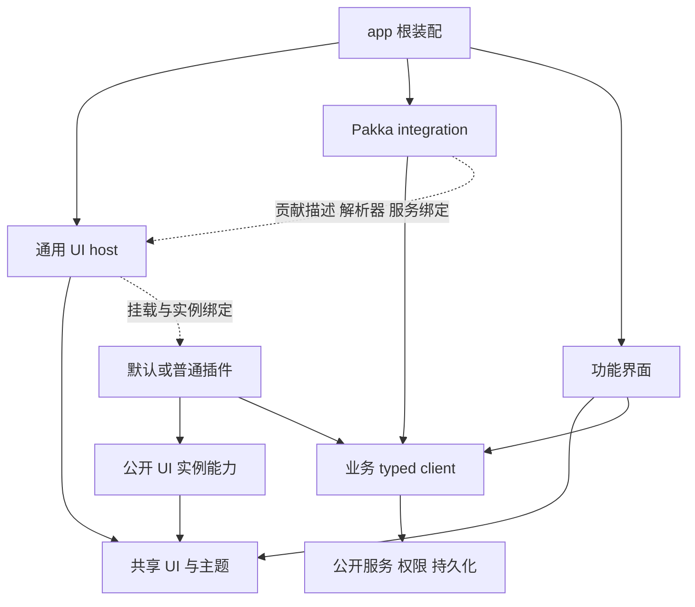

# WebUI 文件结构、职责与接口

先读[开发原则](FRONTEND-GUIDELINES.md)。本文回答：**改一个东西去哪里，谁拥有状态，模块之间传什么，插件能依赖什么。** 采用的产品边界在 [WebUI state](../state/webui.md)，阶段与能力映射在[分仓设计](../../openspec/changes/plan-independent-webui/design.md)。

独立 pakka-webui、React 19 / TypeScript/TSX / Astryx 已作为实施路线采用；下面的目标结构不是已实现或已发布 SDK。第 1、4 节定位已有代码，其他节说明采用的职责和候选文件组织。文件名不是兼容协议，不要求预建空目录。

## 1. 当前代码在哪里

下表相对 Pakka 仓库根；`apps/webui/` 仍是混合 Node/浏览器实现，不能原样搬作独立前端。

| 要找的东西           | 现有入口                                                                | 作用与限定                                                                     |
| -------------------- | ----------------------------------------------------------------------- | ------------------------------------------------------------------------------ |
| 产品包与 exports     | `apps/webui/package.json`                                               | Node 启动和 extension/backend/client/ui/components 同包，安装依赖包含后端      |
| 浏览器入口           | `apps/webui/web/index.html`、`web/app.js`                               | 当前 Preact/htm、import map、页面与导航；后一个简写相对 apps/webui             |
| 容器和插件宿主       | `apps/webui/web/extensions.js`、`sheet.js`、`settings-page.js`          | 注册、实例、加载、错误、focus 与清理；后两个同属 web 目录，不是可深导的 SDK    |
| 公开 UI              | `apps/webui/src/ui.ts`、`components.ts`                                 | WebInterfaceContext/Props 与 Preact Icon/Button/Field/Notice/Stack             |
| 声明、调用与 Backend | `apps/webui/src/extension.ts`、`extension-client.ts`、`backend.ts`      | manifest/schema、checked client、受信任服务与 job 接缝                         |
| HTTP/资产/扩展操作   | `apps/webui/src/http.ts`、`extension-host.ts`、`extension-rpc.ts`       | 身份、权限、generation、原请求和资源字节                                       |
| 服务协议与客户端     | `packages/protocol/src/pocket.ts`、`packages/client/src/pocket.ts`      | 现有 v2 wire、DTO、解码与有限请求；headless 有自己的入口                       |
| Session 来源与导航   | `packages/protocol/src/index.ts`、`apps/server/src/pocket-workspace.ts` | AgentRef、受权 PocketConversationSource；通过公开 protocol/server exports 消费 |
| 业务插件参考         | `packages/rsi/src/browser/`、`packages/mas-devpack/src/browser/`        | 用于识别真实业务需要，不是旧 Preact 插件迁移任务                               |
| 小示例/贡献          | `apps/webui/examples/`、`apps/webui/contributions/`                     | 已有 slots 和 GUI-only 参考，不证明新 SDK 已独立安装通过                       |

现有静态源码在 `apps/webui/web/`，`dist/` 是产物；`scripts/build-browser-vendors.mjs` 不是整个独立前端构建器。上述文件在重构中按责任提取或退出，源码位置不等于未来包归属。全部网络/资产、exports/消费者、功能归属和实际缺口见[阶段 0 清单](../../openspec/changes/plan-independent-webui/inventory.md)。

## 2. 独立前端的目标组织

```text
pakka-webui/                         # 独立前端仓库；先以独立消费切片验证
├─ src/
│  ├─ main.tsx                     # 挂载与根依赖注入
│  ├─ app/
│  │  ├─ App.tsx                   # 组合功能与插件入口
│  │  ├─ AppShell.tsx              # 工作台导航和整体布局
│  │  ├─ AppProviders.tsx          # 主题、连接等明确依赖
│  │  └─ routes.ts                 # 页面路由和通用导航接线
│  ├─ host/
│  │  ├─ ExtensionHost.tsx         # 贡献、模块、版本及实例装配
│  │  ├─ ExtensionSurface.tsx      # page/sheet/panel/settings 容器
│  │  └─ resources.ts              # 通用引用/视图接缝与导航生命周期
│  ├─ integrations/pakka/
│  │  ├─ connection.ts             # 认证、checked client 与连接清理
│  │  ├─ extensions.ts             # 授权发现、服务绑定及资产入口
│  │  ├─ resources.ts              # Session/Conversation 原身份解析适配
│  │  └─ models.ts                 # 模型/Thinking/默认/配置的服务接线
│  ├─ features/
│  │  ├─ conversation/             # 输入、transcript、观察与原请求核对
│  │  ├─ sessions/                 # Session 功能与个人导航
│  │  ├─ settings/                 # 按实际设置对象组织
│  │  └─ authentication/           # Pakka 人类身份登录/邀请/退出
│  ├─ ui/
│  │  ├─ theme/                    # 共享主题及少量实际语义 tokens
│  │  └─ patterns/                 # 已有复用需要的 UI 组合
│  └─ sdk/                         # 纯浏览器的公共 UI 声明/出口
├─ public/                          # 手工静态资源与许可
├─ examples/                        # 按新 SDK 标准安装的消费者
└─ scripts/                         # 明确的构建和制品输出

pakka/                              # 后端仓库继续维护
├─ protocol / client                # 服务契约及独立消费产物的维护源
├─ product bootstrap / HTTP         # 默认启动、身份、固定前端资产装配
└─ agent / MAS / backend services   # 权限、执行、持久化及业务服务
```

- `host` 不知道 `/pakka-webui` URL 或 Pakka Runtime；`integrations/pakka` 把公开服务接到宿主。业务 feature 可以理解 Pakka 对象，领域知识无需被抽象成任意后端平台。
- 每个目录是职责，不是独立 package。小功能可以只有一个文件，需要时再分 view/client/hook；不强制 Page/View/controller/store 全套。
- CSS 与内容就近组织，普通 CSS 或 CSS Modules 均可。公开边界才设 index/出口，不把每层变成转发链。
- 浏览器 SDK 与 Node Backend SDK 各自有纯消费入口，确切包名由安装闭包决定。repo 名与 npm 包名不是同一决定；不为保留旧 `@pakka/webui` 全套名字增加 facade。
- 产物目录、module map、CSS、worker、CSP 和 package files 与构建共同明确；图中没有承诺现有 HTTP 已支持某个新资源路径。

### 常见改动从哪里开始

| 改动                              | 主要位置                                  | 不该借此修改                     |
| --------------------------------- | ----------------------------------------- | -------------------------------- |
| 全站主题、排版、间距              | `ui/theme`，由 app 注入偏好               | 每个 feature 的全局覆盖          |
| 通用容器、关闭、focus、旧实例失效 | `host` 与成熟弹层原语                     | 每个插件各建一套全局 trap        |
| 某个业务页面/管线                 | 所属 feature 或业务插件                   | WebUI 核心的 RSI/MAS/Memo 特例   |
| 用一个 Astryx 公开部件            | 直接消费上游公开入口和宿主共享模块        | 为使用它先扩充受限包装清单       |
| Session/Conversation 解析         | `integrations/pakka/resources` 与公开服务 | host 直接打开数据库或管理 writer |
| 原请求/长操作核对                 | feature/业务 client 与所属服务            | Button 的 Promise 成功回调       |
| 权限、持久化、配置写入            | 所属后端/协议边界                         | CSS 隐藏或浏览器自报 actor       |

## 3. 抽象与依赖方向



| 对象                 | 拥有                                                   | 输入/输出                                          |
| -------------------- | ------------------------------------------------------ | -------------------------------------------------- |
| UI primitive/pattern | 交互呈现、可访问性和局部短暂状态                       | props/parts/children/ref、用户意图；无业务请求身份 |
| 前端 host            | 通用贡献、容器、模块/实例、focus/返回、错误和清理      | 显式贡献/资源解析接缝 → UI 实例能力                |
| Pakka integration    | 连接/认证接线、公开发现、服务绑定、资源与模型 DTO 适配 | 公开 client/受权 DTO → host/feature 消费能力       |
| Feature/业务插件     | 领域页面、草稿、数据适配、命令、工作流/管线及结果解释  | 自身 typed client → 视图/意图/原请求核对           |
| App                  | 根依赖、壳层、路由与默认插件组合                       | 前述部件 → 产品入口                                |
| Backend/service      | 授权、schema、持久状态、原请求和效果                   | 有限输入 → DTO/operation/job/native receipt        |

UI 不反向 import app、业务或服务。host 不 import Pakka 接入实现或某个领域插件；React/browser 不进入 Agent/headless graph。共享 API 模块只定义公开面，不通过 import 自动启动宿主。局部选择/展开就近持有；读取缓存按当前身份/资源隔离，避免复制一份可独立写入的“前端业务真相”。

## 4. 现有公开接口与需要形成的接缝

以下是当前字段定位，不是把旧名字冻结为新 SDK：

| 当前入口                  | 内容                                                                                     |
| ------------------------- | ---------------------------------------------------------------------------------------- |
| `@pakka/webui/extension`  | ExtensionManifest、actions/interfaces/schema、operation 与解码；无 Pi/server/UI 执行依赖 |
| `@pakka/webui/ui`         | WebInterfaceProps/Context，绑定一个界面实例                                              |
| `@pakka/webui/components` | 当前 Preact 五个原语及 IconName；不是已发布 React/Astryx SDK                             |
| `@pakka/webui/client`     | 受控 extension call、operation、operationByRequest、整体 control                         |
| `@pakka/webui/backend`    | BackendContext/Module、服务与可信资源来源；留在后端消费面                                |

当前 `ExtensionInterface` 的 slot 为 page/sheet/panel/settings，scope 为 app/conversation；宿主加载指定 component export 并传 context，已能表达自定义内容，不是 schema-only UI。

| 当前 Context 成员                                     | 语义与新边界                                                       |
| ----------------------------------------------------- | ------------------------------------------------------------------ |
| extension/generation/instanceId/person/target?/signal | 界面身份与寿命；actor 由服务绑定，不是让浏览器授予权限             |
| call/operation/operationByRequest                     | 属于显式服务绑定；复用原请求/回执，不进入纯 UI primitive           |
| subscribe                                             | 现实现为有限 read-action 轮询及 unsubscribe，不冒称通用事件总线    |
| notice/open/close                                     | UI 实例能力；关闭不取消已接纳工作                                  |
| navigate(AgentRef)                                    | 已有 Conversation 导航；通用资源类型与视图解析还要形成最小公开接缝 |

新 SDK 的 UI 能力和 Pakka 服务能力分别定义/实现，消费时可以方便组合。贡献描述、资源引用/解析、服务绑定、实例生命周期与共享模块是最小职责集合，不要求建立五个新框架或一个万能 HostAPI。分 facet 启停须核对真实装配；当前 client.control 只有整体 enable/disable/reload，不能宣称独立 facet 控制已完成。

**原请求身份不能混用。** 当前 `BackendContext.requestId` 是宿主 operation ID，不是浏览器最初的 requestId。丢响应后先 `operationByRequest(browserRequestId)` 找原 operation，再用其已确认结果或 operation ID 核对内层服务。外层 `done` 不证明内层 job 或业务目标完成；unknown 不能用新请求重提消除。

## 5. 通用资源导航与多 Session

现有 AgentRef 已有 Session/Conversation 身份，WebUI 也已有多 Session 基础。新规划补齐的是通用公开消费与原身份/状态核对，不从零重造 Session 系统。

- 插件持有稳定引用并注册自己的资源视图；所属服务/插件解析业务含义，宿主提供导航容器、返回、focus 和不可用状态。
- Session/Conversation 由 Pakka 接入层连接可信公开来源；用户可沿引用进入另一已知且获准访问 Session 的原 Conversation，查看真实过程。
- 持久引用与当前运行绑定分别处理。对已加载、未加载、不可得、无权、身份不符作明确处理，重开后重新解析当前 binding，不拿同名对象替代原身份。
- 浏览只读取历史，不提交模型、重派任务、清锁或恢复执行。原 owner 的服务保持 storage/writer 所有权；浏览器不提供任意数据库路径。
- 资源导航不要求预先实现全 Session 自动发现、统一总览或全局搜索；这些尚未采用。跨机器/进程访问按实际公开服务和部署能力设计。

RSI 报告、MAS 关系图、Memo 书库是消费者，不需要宿主新增 ticket/report/wiki 专用 API。认为能力不足时，先复现公开消费缺口，再以通用职责描述必要演进。

## 6. Astryx、共享运行时与样式

插件可直接使用 Astryx 的公开入口，例如 `@astryxdesign/core/Button`、`@astryxdesign/core/Dialog` 与公开主题能力。Pakka 的便利重导出和自身组合不成为使用其他公开部件的门槛；保留上游 props/parts/hooks/types，不建立缩水的组件语言。使用上游 API 也承担其版本变化，不伪称任意换库零成本。

必须同时成立：

1. 开发依赖和类型对应支持的 React/Astryx 组合。
2. 插件构建对共享 React/ReactDOM/JSX runtime、Astryx 及所需 StyleX runtime 的相关入口 external。
3. 浏览器模块映射确实指向宿主共享资产；不能每个组件独立打包后复制 context。peerDependencies 和 external 各自都不是运行验证。

宿主提供默认主题、所需 layer/locale 及 portal/focus 环境；插件无需另建 root、全局 reset 或第二个壳层。普通 HTML、局部 CSS/SVG、自定义组件及有实际用途的局部主题仍可组合。

- 优先使用上游公开 tokens，Pakka 只添加真实共享语义，不为每个 token 建同义别名。
- 明确 reset/组件/theme/产品局部样式顺序，核对未分层 CSS 的实际优先级。
- portal 离开原 DOM 子树后，主题、字号、方向和层级仍一致；每个浮层只有一套 focus trap/Escape/return 实现。
- 插件样式只作用于所属内容。这是维护边界，共享同源 UI 不被当作恶意代码安全沙箱。
- 预编译 Astryx 消费不要求应用采用 StyleX 编译器；确需 swizzle/fork 时记录固定来源、许可、变更和升级责任，并验证混用的共享 context。

## 7. 插件作者与实施顺序

插件以真正需要的 facets 和服务开始，browser 入口输出普通 React 内容，业务 client 解释自己的 DTO/错误/长操作；UI 能力与可选服务绑定经公开 SDK 获得。Agent-only 与 GUI-only 分别消费，不靠根 overrides、私有路径或第二份 UI runtime 解决依赖。

业务插件可在自己的包中使用 manifest、backend、agent、browser 等职责目录，只有实际需要才创建；分仓不强迫一个全栈插件拆成两个 repo。默认插件通过 composition root 显式装配，与第三方走相同入口。

用户已明确旧 Preact 插件不迁移，旧 WebUI/SDK 按没有用户处理。更干净时移除旧入口和 facade；不把兼容工程或维持旧默认界面作为前置。仍需的产品功能按用途在新 SDK 上接入，权限、原 Session、持久记录和已接纳工作继续保留。

推进顺序为完整盘点/独立消费接缝 → 最小真实前端/插件/跨 Session 切片 → 搬仓 → 补齐功能 → 默认交付收口；具体退出条件见[阶段设计](../../openspec/changes/plan-independent-webui/design.md#migration-plan)。新 SDK 的安装、共享 runtime、模型配置和资源浏览均须实测；源码表、目录图和文档检查不构成通过证据。

验证优先采用类型/构建、独立安装和真实界面/服务检查，新增持久测试按[少测试政策](FRONTEND-GUIDELINES.md#重构初期的测试政策)说明独特风险。Provider `/login` 的多端交互继续按规划延期，Pakka 人类身份登录与安全边界不受影响。
