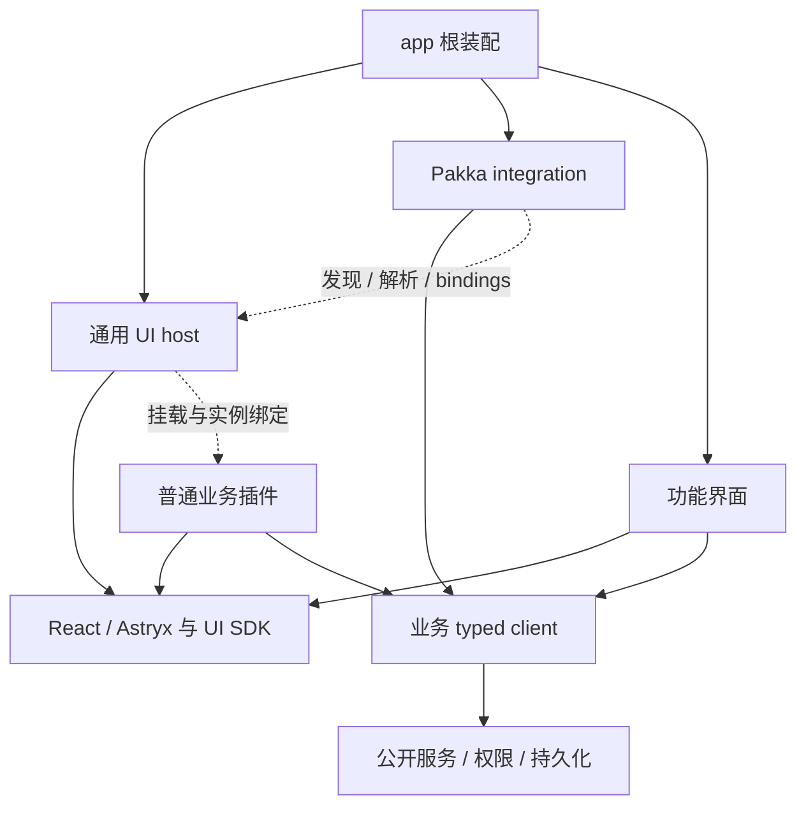

# WebUI 文件结构、职责与接口

本页用于定位源码、状态所有者与公开接口。产品边界见 [WebUI state](../state/webui.md)，插件作者入口见独立仓库的 [UI SDK](https://github.com/mapleluvr/pakka-webui/blob/pakka/independent-webui-seams/docs/development/UI-SDK.md)，采用来路与任务见[分仓设计](../../openspec/changes/plan-independent-webui/design.md)。

## 1. 代码入口

Pakka 维护 Node 装配、服务与业务插件；独立 pakka-webui 维护浏览器应用、通用宿主、UI SDK 与 Pakka 接入层。两仓通过公开包和固定归档配对。

| 职责                         | 仓库与入口                                                                                                    |
| ---------------------------- | ------------------------------------------------------------------------------------------------------------- |
| 默认启动、固定前端与 HTTP    | Pakka `apps/webui/src/bootstrap.ts`、`default-frontend.ts`、`assets.ts`、`http.ts`；CLI 在 `apps/cli/`        |
| Extension 声明与 wire        | Pakka `packages/protocol/src/extensions.ts`、`extension-rpc.ts`                                               |
| 服务 DTO/decoder 与客户端    | Pakka `packages/protocol/src/pocket.ts`、`webui.ts`、`webui-assets.ts`；`packages/client/src/`                |
| Backend 调用、权限与回执     | Pakka `apps/webui/src/extension-host.ts`、`backend.ts`；业务服务在 `apps/server/src/pocket-*.ts`              |
| 根装配、主题、导航与页面     | pakka-webui `src/app/Application.tsx`、`WorkspaceNavigation.tsx`、`useViewNavigation.ts`                      |
| 通用 registry 与实例         | pakka-webui `src/host/registry.ts`、`facet.ts`、`lifetime.ts`、`InstanceView.tsx`                             |
| 认证、资源、扩展和观察接线   | pakka-webui `src/integrations/pakka/`                                                                         |
| Conversation 与工作台        | pakka-webui `src/features/conversations/`；包括 Composer、历史、原文、配置、协作与 Session 创建/恢复          |
| 人类身份与设置               | pakka-webui `src/features/identity/`、`src/features/settings/`                                                |
| 公共 UI 类型与 React context | pakka-webui `src/sdk/contracts.ts`、`index.ts`、`react.tsx`                                                   |
| 共享模块、应用与归档         | pakka-webui `scripts/build-runtime.mjs`、`build-app.mjs`、`pack-app.mjs`                                      |
| 业务 React 页面              | Pakka `packages/rsi/src/browser/`、`packages/mas-devpack/src/browser/`、`apps/webui/contributions/*/browser/` |
| 固定应用与 SDK 配对          | Pakka `integrations/webui/`                                                                                   |

`@pakka/webui` 构建清空自己的 dist，校验并装入固定前端，再编译所属 Backend 与普通贡献。独立前端归档已包含共享 runtime、应用、worker 和上游许可，消费者启动直接装载经过 manifest 校验的字节。

## 2. 组织与依赖方向

| 对象              | 拥有                                 | 输入与输出                              |
| ----------------- | ------------------------------------ | --------------------------------------- |
| UI 部件           | 交互、可访问性和局部短暂状态         | props、parts、children、ref 与用户意图  |
| host              | 贡献、容器、实例、返回、focus 与清理 | 显式贡献/资源解析 → 实例能力            |
| Pakka integration | 认证、公开发现、资源与服务绑定       | 受权 DTO/client → host/feature          |
| feature/业务插件  | 草稿、领域页面、命令、业务结果解释   | typed client → 呈现、原请求与显式操作   |
| app               | 根依赖、壳层与默认组合               | 前述部件 → 产品入口                     |
| Backend/service   | schema、权限、持久状态和实际效果     | 有限输入 → operation/job/native receipt |

host 的服务发现和资源解析由调用方注入；领域页面由所属 feature 或插件维护。UI 原语不读取运行数据库，React/browser 不进入 Agent/headless 依赖图。页面内草稿就近持有，读取按身份、资源和生命周期隔离。

目录表示职责。按实际复用分离文件与组件，CSS 与内容就近组织；公共边界设置 exports，局部小功能可由单个文件承载。实现位置和私有 props 可调整，公开协议、权限与恢复语义分别核对。

## 3. 公共消费接口

| 入口                                                  | 内容                                                     |
| ----------------------------------------------------- | -------------------------------------------------------- |
| `@pakka/protocol/extensions`、`extension-rpc`         | manifest/schema、资源及 extension wire/decoder           |
| `@pakka/client/extensions`                            | call、operation、operationByRequest、整体与逐 facet 控制 |
| `@pakka/protocol/webui`、`@pakka/client/webui`        | 服务版本、身份绑定、配置、资源与原请求查询               |
| `@pakka/protocol/webui-assets`、`@pakka/webui/assets` | manifest 与 Node 固定字节消费                            |
| `@pakka/webui-sdk`、`@pakka/webui-sdk/react`          | React 贡献、UiContext 与同一 context 实例                |
| `@pakka/webui/backend`                                | BackendContext/Module、可信服务和资源来源                |
| `@pakka/webui/workflows`                              | 所属业务贡献根目录与服务装配                             |

UiPlugin 声明 runtime/API、views 与 commands。view 的 placement 为 page/panel/sheet/settings，render 接收 `UiViewProps`；`ui` 与显式 `bindings` 分别提供界面能力和业务服务。组件可直接消费共享的 Astryx 公开部件。

| UiContext 成员                                  | 作用                                      |
| ----------------------------------------------- | ----------------------------------------- |
| instanceId/pluginId/generation/resource?/signal | 所属实例、资源与可中止读取生命周期        |
| notice/open/close                               | 呈现反馈、打开视图与关闭当前实例          |
| navigate                                        | 解析稳定 ResourceReference 并进入相应视图 |
| dispatch                                        | 调用指定 plugin 的 UI command             |
| onDispose                                       | 同步注册与执行实例清理                    |

Pakka Backend binding 在服务端绑定 Person、资源、当前 generation 和权限。四个 facet 分别发现、控制与失效；关闭 UI 释放本实例观察，已接纳工作继续由服务维护。

`BackendContext.requestId` 是宿主 operation ID。丢响应后，先用浏览器原 requestId 查询 `operationByRequest`，再使用确认的 operation 结果或其 ID 查询内层服务。外层 done、原生投递终态和业务目标完成分别判断。

Backend command 的 scope/effect 来自声明。write/model 的完整原请求按 Person/App 或原 Conversation 保存；恢复只查询该请求，unknown 保持待核对。read 返回本次读取结果，失败可显式再读。普通 slash 字面输入与命令按当前声明分流，疑似命令发现失败时保留草稿。

## 4. 原资源与多 Session

插件使用稳定 ResourceReference 注册资源视图。Pakka 接入层按 Session/Conversation 完整身份解析，分别呈现已加载、未加载、不可得、无权和身份不符。加载状态决定执行入口；已登记且获准的保存历史可通过只读路径浏览。

资源导航提供容器、返回和 focus；服务拥有存储、writer、授权与真实内容。跨 Session 同号资源仍按完整身份区分。浏览历史不提交模型工作。RSI 工单、MAS 成员和 Memo 内容各由所属插件解释，通用宿主只处理引用与视图生命周期。

Session 创建、Conversation 创建、原 Session 重开是不同操作。写入前保留完整原请求，丢响应后查询所属回执；单独的当前目录或资源状态读取不替代原写入回执。原 Session 的可恢复打开可通过成功的后续目录读取确认可用状态。

## 5. 共享 runtime、主题与样式

React/ReactDOM/JSX runtime、Astryx、所需 StyleX runtime 和 SDK context 由宿主共享模块提供。插件的依赖声明、构建 external、浏览器 import map 分别落实到支持的版本组合。

默认主题使用上游预构建主题与静态 CSS，符合生产 CSP。app 提供主题、字体/字号及 portal 环境；插件使用公开 tokens、普通 HTML、局部 CSS/SVG 和自定义组件。浮层共用成熟原语处理 focus、Escape 与返回，每个打开实例清理自己的事件与样式。

共享同源插件是可信装配。CSS 隔离属于维护边界；服务的 schema、资源与 Person 检查负责操作授权。需要 swizzle/fork 时明确来源、许可和升级责任，并验证 context 身份与混用行为。

## 6. 构建、使用与验证

独立前端构建和 SDK 开发见其 [README](https://github.com/mapleluvr/pakka-webui/blob/pakka/independent-webui-seams/README.md)。Pakka 的安装、固定选择、更新和兼容回退见 [integrations/webui](../../integrations/webui/README.md)。源码、Node 包、静态归档、协议版本和 runtime/SDK 分别记录身份。

新增持久检查按[少测试政策](FRONTEND-GUIDELINES.md#重构初期的测试政策)说明独特风险；优先采用类型/构建、独立安装与真实页面/服务路径。原生录音、系统通知显示、服务接纳与协议合法性各有自己的证据范围。实际阶段结果由[验证入口](../verification/README.md)承接。
