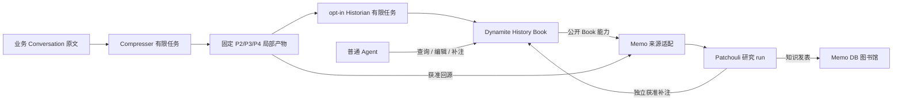

# History Book 与图书馆协作

普通 Agent 直接使用 Dynamite 的 History Book。自动记史和 Patchouli 研究分别由宿主启用；来源产物、Book 修订和 Memo 知识具有各自的持久身份、权限和结果回执。



## 安装与入口

选择 [History Book state](../state/history-book.md) 对应的固定归档组合，安装 Agent 与 Dynamite 即可使用独立 Book。完整 API 和独立示例在 Dynamite 包的 `docs/HISTORY-BOOK.md` 与 `examples/history-book.mjs`。该示例只创建一次性存储、编辑、补注、读旧版本并重开，不需要 Memo 或模型服务。

宿主提供两条不同的读取能力：

- `runtime.artifactHistory(source,strategyId,check)` 以固定上界分页已提交的产物批次，按精确 reference 读取局部对象。
- `runtime.readHistoricalEntry(source,{entryId,contentVersion,offset,limit},check)` 读取原 archive 中该版本的消息。当前投影变化不会替换原引用；不可恢复的有效版本明确拒绝。单对象预检上限 1 MiB，每页至多 16,384 个 Unicode code point。

这两者属于可信宿主控制面；普通 Agent 经 Dynamite 工具及宿主当前调用作用域使用 Book，不取得可变 Pi 句柄或任意 Session 读取权。

## 记史工作与恢复

`createHistorian` 绑定一个业务 Conversation 与固定产物 namespace。创建、读状态或使用已有 Book 不创建 Historian 执行资源。宿主提供延迟打开的 `createHistorianSession`，它使用独立存储；每个有限工作有自己的原生 Conversation。默认一次批量最多 8 个产物，从来源倒排索引与导航上下文选择至多 16 个既有实体。

先调用 `enable({from:"future"})` 保存输入边界，再显式 `start()` 或 `pump()`。暂停保留输入位置；停用后重新启用需选择 `future`、`catch-up` 或固定 `backfill` 区间。重开恢复原身份与数据，新的执行仍需当前权限。

原生任务完成表示形成封存候选。Book 发布完成还要求：当前编辑权限有效、基版未变、结果与原 child/attempt 一致，并且 Book 根、输入 checkpoint、原结果采纳回执和工作完成在原业务 SQLite 同事务提交。相同 bundle 的消费指纹也在该事务内确认。

原生响应丢失时查询原工作。确认已有封存结果只进行本地补记；无法确认的工作继续占据本 Book 的串行位置。管理者显式跳过时保存缺口与原消耗，并核对原生活跃索引退出。Agent 已提交的编辑导致旧候选冲突；已知结果可以显式 rebase，未知结果不能通过新工作重发。

## Patchouli 的消费与完成条件

`@pakka/memo/dynamite` 导出的 `createDynamiteSourceProvider({book,check})` 由 Memo 管理。它只消费公开 Book 读取、固定版本及同步授权端口，不使用 Dynamite 私有类型或存储；不需要上游新增图书馆接口。宿主把它以一个 provider 名称装入 Memo 和 Patchouli，登记 `address=book.bookId` 与固定 `version=String(revision)`。

```js
import { createDynamiteSourceProvider } from "@pakka/memo/dynamite";
const providers = {
	history: createDynamiteSourceProvider({
		book: historian.book,
		check: (access) => checkCurrentLibraryShareAndRead(access),
	}),
};
```

登记需要 share 权；read 同时核验书库分享范围、Book 自身读权及实际回源对象。Book 的已保存引用和来源窗口的子引用是其所属对象的元数据，不自动继承被引用对象读权；真正读取子对象时才检查它。适配器不为目录或检索元数据复读全部实体，不增加跨来源连带授权。

Memo 将固定 Book 版本的实体与来源窗口转换成不透明导航地址。每页最多 32 个引用、每个 locator 最多 1,024 字符，回源路径最多 32 层；长引用留在原对象中，续页重放原窗口并核对全部子引用的有序指纹。换序或身份改变明确拒绝。实际读取的路径在最终返回前同步复查；未选中兄弟或仅返回的子导航不进入额外目标正文授权。

来源结果的 `publicationCheck` 由 Memo 在复制 DTO 前取得，再传过 Memo、Patchouli 和原生工具的最后异步边界；它只保存本次实际读集与授权，不是持久权利或知识污染规则。外部异步消费者按 [Memo API](../reference/MEMO-API.md) 保留原结果检查。Memo Wiki 仍使用独立书库权限。

[完整组合示例](../../integrations/dynamite/history-library.mjs)执行以下可核对的工作：

1. 业务 Conversation 产生原文，真实 Compresser 发布结构化局部产物，Historian 发布 Book。
2. 建立 Memo 书库、授予 Patchouli 编辑权，登记固定 Book 版本。
3. 保存研究请求；请求入队阶段不调用模型。
4. 显式启用并推进 Patchouli，通过 `memo_search/read` 读取真实来源。
5. 通过 `history_annotate` 在 Dynamite 保存补注，再通过 `wiki_write` 向 Memo 发表知识；两者独立授权和确认。
6. `research_finish` 结束研究 run，等待原生 Conversation 空闲，再核对发表引用、原 Book 修订和独立补注。
7. 正常关闭并重开两个原存储域，核对原 run、Wiki 与 Book，不追加模型请求。

研究 run 完成不能由单次 generation 结束推断。示例的完成条件是：原 run 为 completed、存在预期 Wiki 发表引用、正文与固定来源可读、Book 补注已提交、原生工作已空闲，重开后各结果仍可核对。一般研究可以无发表完成，其语义由 Patchouli 明确结束动作决定。

Book 与本域记录在业务 Session SQLite；Historian 的任务、seal、attempt 和结果在独立 Historian SQLite；Memo 知识与研究记录在独立 Memo SQLite。三者按固定身份恢复，不共享跨库事务。

## 本地确定性验证

在 Pakka checkout 中用已构建的固定归档执行：

```powershell
npm run smoke:history -- --agent <pakka-agent.tgz> --dynamite <pakka-dynamite.tgz>
```

runner 先建立只有 Agent＋Dynamite 的仓库外消费者，检查独立 Book 和被动重开，再安装 Memo＋MAS，检查实际 Book 与 Memo 结构端口的声明兼容、来源导航/发布边界及上述真实工具链。使用独立 profile、loopback provider 和本地假 key，不读取用户凭据。每一步记录实际退出状态；原始日志和安装清单仅保存在本地。

这种验证证明持久化、权限、调用与恢复的机械路径。真实模型对复杂史料的关系判断、综合叙述及研究价值需要另行限定任务、材料、费用和效果的实验，不能由确定性回答推导。

固定结果和证据包身份记录在所属验证摘要；形成与任务见 [History Book change](../changes/history-book.md)。
