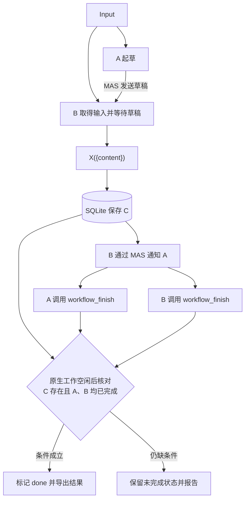

# 使用 Pakka 编写协作流程

Pakka 提供独立的 Conversation、MAS 成员通信、自定义工具和持久状态。人和 Agent 可以用应用脚本组合这些能力，编写并行处理、交接、讨论、返工与结果汇总流程。流程定义保存在程序、角色指令和配置中，宿主装配模型、工具、权限与运行资源。

本页以 [workflow.mjs](../../examples/workflow.mjs) 为可运行示例。人可以从图和运行入口开始；负责制作 workflow 的 Agent 应结合本页形成流程图、代码、产物与状态的保存说明，以及实际取得的验证结果。具体工作需要多大恢复能力，由使用方式和中断后果决定。

## 1. 先把协作关系画出来

编写或调整 workflow 时，使用 Mermaid 表达输入、参与者、消息与工具、产物和完成条件。有返工、等待、次数上限或异常出口时，把对应路径画出来。图应与实际代码及指令对应；角色和控制关系变化时一起修改图。

示例选择 A 起草、B 校对并保存结果，两者通过 MAS 通信：



图中的 A/B 分工是本例的安排。设计自己的流程时，先写清输入是什么、各参与者处理什么、怎样交换信息，以及哪些可检查的事实表示完成。例如，“正文已保存且两名成员都确认完成”和“两个 Conversation 暂时空闲”是不同条件。

需要展示恢复行为时，可以另画状态图，标明已确认提交、未确认效果和重新取得权限的位置。图的作用是帮助核对真实关系；程序中的提交与回执是判断执行情况的依据。

## 2. 运行完整示例

在仓库根目录构建，再运行本地确定性检查：

```powershell
npm run build
node --test scripts/workflow-example.test.mjs
```

这组检查自动启动 loopback provider，使用真实 Pi、工具调用、MAS 和 SQLite，环境与凭据隔离。provider 按固定规则回答，不需要真实模型服务。

运行自己的模型时，在取得相应授权后显式提供配置：

```powershell
$env:PAKKA_ENDPOINT = '<approved-openai-compatible-base-url>'
$env:PAKKA_MODEL = '<approved-model-id>'
$env:PAKKA_API_KEY = '<operator-supplied-key>'
$env:PAKKA_WORKFLOW_DIR = 'artifacts/my-workflow'
node examples/workflow.mjs '根据给定材料起草一份简短指南，并核对后保存。'
```

上面的值是占位符。示例默认使用本机 endpoint 和 `local-only`，没有自带推理服务；接入外部模型的验证安排见第 5 节。凭据由操作员明确提供，保存在运行环境中，不写进流程图、脚本、输出或报告。

示例输出包含 `sessionFile`、状态、投递回执和导出路径。C 的原件与完成标记在所属 Session 的 SQLite 中；`C.md` 和 `run.json` 是便于阅读的导出。程序退出码为 0 表示本例的完成条件成立，为 1 表示条件未满足或执行发生错误；结合实际报告区分原因。

重开已知运行时，用相同输入和原配置显式指定输出中的 `sessionFile`：

```powershell
$env:PAKKA_REOPEN_FILE = '<sessionFile-from-the-original-run>'
node examples/workflow.mjs '<the-same-original-input>'
```

本例在重开时核对原定义与输入，读取已保存的结果和标记，不重新投递输入。创建新运行前清除该变量：`Remove-Item Env:PAKKA_REOPEN_FILE`。未完成运行在本例中保持未完成；阶段式续行需要按第 4 节设计。

## 3. 把要求落实到程序与角色指令

| 协作要求         | 使用的能力                                   | 应用需要决定的内容                 |
| ---------------- | -------------------------------------------- | ---------------------------------- |
| A/B 独立工作     | Conversation、profile、MAS membership        | 指令、工具、模型和寿命             |
| 同一输入并行分发 | 并行调用 `MasClient.send()`                  | 输入内容、原请求身份与额度         |
| Agent 自行交流   | DevPack 的 `mas_send`、`mas_reply` 等工具    | 接收对象、交流内容、交接与停止规则 |
| 确定的顺序与条件 | 普通程序的等待、分支和循环                   | 何时进入下一步、何时退出或报告问题 |
| 保存 C           | 自定义工具 X                                 | 保存内容、版本、可读引用和确认方式 |
| 双方完成         | 应用工具 `workflow_finish` 与协调状态        | 谁确认了哪个运行、哪个结果         |
| 持久进度         | `runtime.store()`；按需使用 `runtime.jobs()` | 提交阶段与重开行为                 |

宿主批准 profile，并通过 `createMasProfilePacks()` 给 Agent 提供带真实调用身份的工具。自定义工具的角色来自宿主装配；示例在提交前用 `catalog.checkInvocation()` 核对实际 invocation。模型参数用于表达业务内容。

流程主体并行投递输入，随后由 Agent 交流并调用工具：

```js
await Promise.all(
	["A", "B"].map((role) =>
		operator.send(members[role], {
			requestId: "input-" + role,
			text: kickoff,
		}),
	),
);
await runtime.waitForIdle();
```

完整脚本从 store 读取最新状态，再检查：

```js
const complete = Boolean(state.artifact && state.finished.A && state.finished.B);
```

`workflow_finish` 和 X 是应用定义的工具。业务完成的判断也在应用中；一次 generation 回执 `done` 表示该次输入得到回答。产物的内容质量需要另外检查。

按任务选择控制方式：程序可以明确规定每次交接，Agent 也可以在获准范围内自己决定交流内容。示例中的本地写入队列只串行化状态提交，A/B 的模型工作仍可并行。忙碌成员的消息用原生 `followUp` 或获准的 `steer` 表达对应投递时机。

持续协作可使用 `persistent` 成员。选择 task-bound、temporary 或 background 时，按 [MAS 生命周期](../reference/MAS-API.md#生命周期配置与失败)核对其实际归属。成员通信、完整历史读取和管理分别使用对应权限。

修改协作方式时，沿实际依赖调整：让 A/B 独立评审，就把双方结果分别交给汇总步骤，并将完成条件绑定到两个结果；增加返工，就保存有限轮次及候选版本，让确认对应到当前候选，并在定稿时调用 X 封存。相应角色指令、流程图和检查用例一起变化。

## 4. 逐项决定产物与状态怎样保存

在实现工具和阶段转换之前，列出本次流程实际会产生的内容。结合用途考虑哪些是最终结果、哪些是后续步骤的输入、哪些只在当前计算中有用，以及哪些能从既有记录重建。说明可以是一段文字或小表，结构随真实对象安排。

对需要持续使用的内容，交代保存位置、身份或版本、何时确认成功、重开如何读取，以及清理后会影响什么。既有可靠来源可用固定引用和留存关系连接；体积较大的文件、包和媒体可以保存到内容存储，协调状态记录其确切引用。

| 本例内容                     | 保存与使用方式                                              |
| ---------------------------- | ----------------------------------------------------------- |
| 程序、角色指令、配置约定     | 代码版本；重开核对原运行身份及配置                          |
| 输入、当前阶段、A/B 完成标记 | `runtime.store()` 中的 JSON，CAS 提交                       |
| C 的正文                     | 同一 store 中封存；重复确认同一内容可核对，替换内容明确拒绝 |
| 消息、工具轨迹、投递结果     | 原生 Conversation 与持久 MAS 回执                           |
| `C.md`、`run.json`           | 可由原件重新生成的阅读导出                                  |
| 当前工具调用权限             | 由当前宿主与 invocation 重新取得                            |

需要特别斟酌以下关系：

- 完成标记绑定哪一个产物版本；产物变更后，原确认是否仍成立。
- 产物写入与完成标记能否在同一效果域提交；若保存文件和写状态分属不同域，怎样核对中间状态。
- 发送前用哪个稳定请求 ID，收到后保存哪个回执；等待超时后怎样找回原操作。
- 运行中断时，哪些阶段可以继续、哪些外部效果尚未确认；重复调用工具是否有幂等依据。
- 何时可以清理中间结果，后续引用、重开、审查或导出是否还依赖它。

普通变量适合进程内计算。要重开进度，用持久状态表达阶段；需要调度长期程序时，可注册命名、版本化的 Runtime job，在安全阶段提交 checkpoint。重开后程序依据已提交 checkpoint 续行；执行到一半且效果不明的操作保留为 unknown，先核对原身份和结果。当前示例提供结果重开，不包含任意 JavaScript 调用栈恢复。

选择恢复强度时结合实际后果：短小、可重新生成的实验与需要保留外部效果的长期流程，可以采用不同安排。字段、文件和阶段只保存本次流程真正需要的内容。

## 5. 逐级取得可行性证据

制作 workflow 的 Agent 应提出下面的验证顺序，并结合用户目标选择本次范围。每一层回答不同问题；把实际运行和观察写清。项目中 Verification 的选用与一次性记录规则见[验证工作方式](../development/VERIFICATION.md#选用与记录)。

### 第一层：普通测试

先检查程序语法及不依赖模型的逻辑：输入约束、完成条件、有限循环、状态更新、产物版本关联、重复确认和失败出口。用最少的针对性用例覆盖真实分支，避免为每行实现复制一个断言。

```powershell
node --check examples/workflow.mjs
```

这条命令只检查语法。阶段、版本或幂等逻辑需要对应的普通测试。例如，C 存在但 A 尚未完成时，流程应该保持未完成；新的 C 版本是否可以沿用旧确认，应按该流程的约定验证。

### 第二层：真实 Runtime 与确定性推理测试

通过本地 HTTP provider 给出可控模型响应，实际运行 Conversation、DevPack、自定义工具和存储。核对消息确实送达、工具确实执行、C 实际保存、完成条件正确，以及重开和故障行为。需要模拟时序时，在具体边界受控延迟或失败。

```powershell
node --test scripts/workflow-example.test.mjs
```

现有用例覆盖正常交流、X 保存、双方完成、重开零额外 HTTP，以及“已有 C 且成员空闲，但 A 未明确完成”的反例。它们证明脚本在这些规定响应下怎样运行；真实模型是否理解角色指令仍需后续证据。

仓库自动回归使用隔离环境和本地确定性 provider，记录实际 HTTP、工具效果和存储结果。

### 第三层：经用户批准的真实模型小任务试跑

前两层通过后，Agent 应主动提出一项小规模真实模型可行性试跑请求。选择当时可用、支持所需工具调用、便宜且响应快的模型，用简单且对口的任务检查实际协作。模型价格与可用性以当前 provider 信息为依据。

试跑请求说明：

- 确切 provider/model、使用的输入，以及会发送的数据和会产生的效果。
- 任务与成功条件，例如使用给定三条事实生成短说明，由另一角色核对后通过 X 保存，再确认双方完成。
- 运行次数、模型调用尝试上限、输出 token 上限、并发度，以及可核实的费用估算；无法确定的费用依据明确说明。
- 输出保存位置、如何停止，以及失败后准备核对什么。

请求可以这样写，提交前把占位项替换成实际安排：

> 普通测试和确定性链路已通过。申请用 `<provider/model>`，对 `<简单对口任务及数据>` 试跑 `<次数>` 次；最多 `<调用尝试>` 次生成、每次最多 `<输出 tokens>`、并发 `<数量>`，预计费用 `<金额或无法估算的原因>`。成功条件是 `<产物与协作行为的检查>`，结果保存到 `<位置>`。是否批准这次安排？

取得对具体范围的用户批准后才执行；已有适用授权时沿用其范围。凭据由用户或受信任宿主显式提供，不读取用户凭据目录；真实模型试跑单独运行和记录，不加入自动回归默认路径。扩大模型、数据、预算或工具效果时重新取得相应授权。

执行前把获批的生成尝试上限落实到 Runtime 的 `limits`，把输出上限落实到 `maxOutputTokens`，并在程序中约束轮次和工具效果。attempt reservation 是尝试额度，不等于实际 HTTP 数、token 总额或账单金额；费用按取得的 usage 和有效价格核算。

观察模型是否理解分工、能否找到对方并使用工具、是否等待正确结果，以及 C 是否满足任务要求。把 schema/脚本错误、模型使用能力、指令歧义和任务难度分别定位，再修正受影响部分。简单任务通过提供初步可行性证据，复杂任务再逐步扩大。

## 6. 交付可继续使用的流程

交付可运行脚本、配置方式、与实现一致的 Mermaid 图、实际结果入口，以及产物与状态的保存和重开说明。图和说明可以放在同一 README；必要时链接更详细材料。

验证记录区分普通测试、确定性推理和真实模型试跑，注明各自实际输入、运行版本、模型或 provider、结果与仍未解决的问题。真实模型阶段保留获批范围、实际调用/usage、能核实的费用和产物检查。用户没有提供价格依据时保留未知，不用默认零价格推断免费。

Agent 交付时，应使接手者能回答：怎么启动、A/B 怎样合作、如何判断完成、结果在哪里、进程退出后留下什么，以及重开后下一步怎样处理。运行失败时保留定位所需记录，按原操作身份核对后再决定续行或新建运行。

## 接口与执行入口

- [完整示例](../../examples/workflow.mjs)、[本地确定性用例](../../scripts/workflow-example.test.mjs)。
- [Runtime API](../reference/RUNTIME-API.md)：创建、store、限额、重开与 job/checkpoint。
- [MAS API](../reference/MAS-API.md)：成员、投递身份、回执与生命周期。
- [MAS DevPack API](../reference/MAS-DEVPack-API.md)：模型侧工具与当前 invocation。
- [应用配置](MAS-APPLICATION-API.md)：HTTP server、client 和 CLI 装配。
