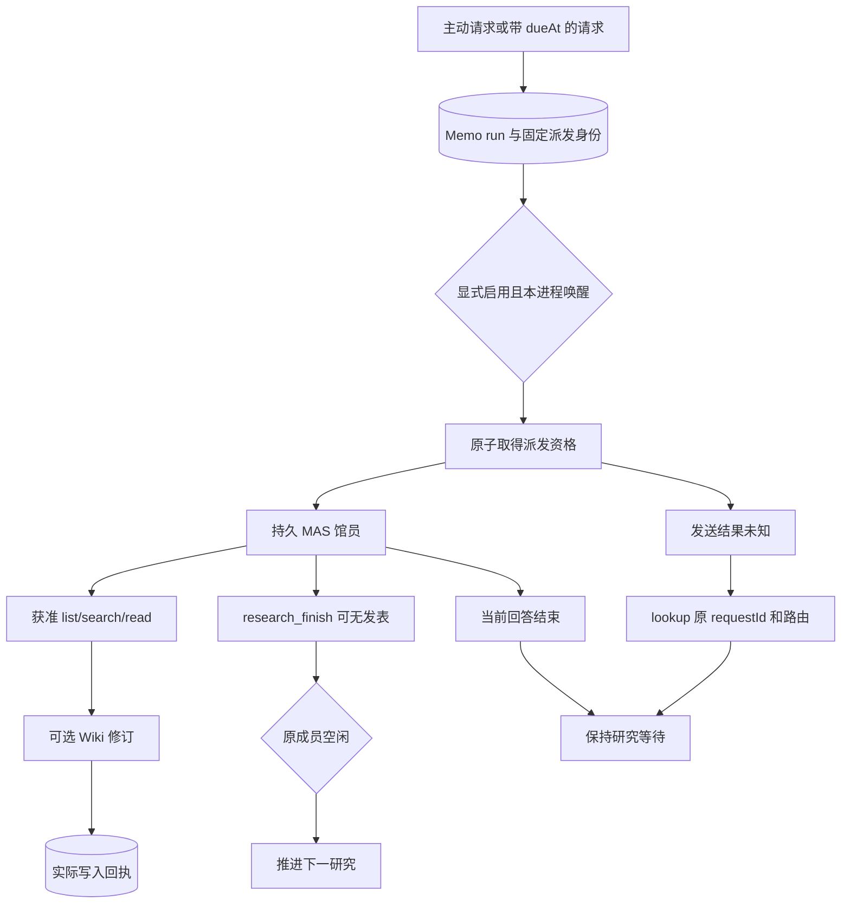

# 持久 Patchouli

[示例](../../packages/memo/examples/patchouli.mjs) 将 Memo 知识服务装配为一名可选的持久馆员。知识 SQLite 保存书库、修订和研究 run；Runtime SQLite 保存模型上下文、工具轨迹和 MAS 投递。详细轨迹不再复制到 Memo。



`openPatchouli` 不创建成员，也不装配模型。可信宿主先创建/恢复原 Runtime，核对原 persistent 成员，再通过 `createMasResearchDriver` 绑定 send/observe/abort。馆员工具由 `createPatchouliTools` 注入该成员 profile；根 Conversation 不自动拥有这些工具。

`connect(actor)` 的 `request` 非阻塞地保存主题、refs、可选 dueAt，返回 runId；同 actor/requestId/参数查回原请求。`setEnabled(true)` 允许执行；`advance()` 每次核对或派发一项工作；`start(intervalMs)` 在当前控制者授权下显式启动进程内唤醒，返回停止函数。普通重开不会启动该计时器。`get` 始终被动。`cancel` 先持久记录停止意图；未知效果不等于已取消。`advance` 会在原接纳可确认后继续该取消。run 的 `executionHeld` 与业务 state 分离：调用 research_finish 后，只要原生成尚未退出，仍可以取消它；已经释放执行槽位的历史 run 不再具有取消成员的资格。业务完成的 run 停止生成后仍保留 completed 及原发表回执。

自定义 `ResearchDriver.cancel(requestId, check)` 必须在效果前调用当前授权检查，并在同一实时 Runtime 中按原 requestId 合并并发取消直至原操作结束。拒绝或异常返回不得遗留会绕过授权检查的延迟效果。内置 MAS driver 在同一 Runtime 对象的多个服务句柄间共享原取消；Runtime 重开后，仅持有原执行槽位的显式恢复可以重试取消。取消未确认标记保存在 Memo，不能用进程内 promise 代替持久恢复状态。

主模型 generation 完成不会结束研究。`research_finish({runId})` 不要求额外报告；工具在最后一次 await 后复查当前 contribution、lease、invocation 与原完成结果权限。服务提供 `publicationCheck(originalResult)` 给需要再次异步处理完成结果的消费者，复制或其他服务的结果不被接受；调用 verifier 后到发布之间不能再次 await。完成已提交后失权返回 unknown，原 run 仍为 completed，可按原 runId 查询，不撤销或重复完成；`publications` 只包含该 run 前缀下实际持久的 Wiki 回执。待处理请求数量和单 run 发表数有明确预算，完成的历史不占待处理额度。运行与请求记录独立增长。

每个绑定的 scope 和原始 route 在重开时必须完全一致；不同研究范围使用独立上下文。宿主 `authorize(actorId, action)` 约束整个研究的 request/read/control，实际工具还检查 enabled、active run、native invocation、书库角色和来源授权。已有私有上下文的发表约束由可信装配保持，不能只检查最终 citations。首版 scope 不支持原地扩权/缩权后复用旧私有上下文。

## 运行与重开

```powershell
$env:PAKKA_ENDPOINT = '<approved endpoint>'
$env:PAKKA_MODEL = '<approved model>'
$env:PAKKA_API_KEY = '<host-supplied credential>'
node node_modules/@pakka/memo/examples/patchouli.mjs D:/private/research read-1 '阅读已有知识'
node node_modules/@pakka/memo/examples/patchouli.mjs D:/private/research read-1 '阅读已有知识' --execute
```

第一条只保存/核对请求；第二条显式推进。之后同目录会从 `runtime.json` 重开原 Session，核对原成员和原 run。不要删除该文件来绕过身份不符或未知存储。

| 保存对象                       | 位置与核对                                          |
| ------------------------------ | --------------------------------------------------- |
| Wiki、权限、研究、原请求       | Memo SQLite，事务确认后可查询                       |
| 成员、完整上下文、工具与 usage | 原 Runtime SQLite / MAS                             |
| Runtime 文件定位               | 私有示例目录 runtime.json，丢失时从实际身份记录恢复 |
| 发表列表                       | Memo 中真实 Wiki mutation receipts，不由模型自报    |
| 当前 lease、工具 scope、计时器 | 重开后由宿主重新授权，不能持久化当权限              |

示例最多两个 Conversation、八次 primary attempts，不授予 shell/网络工具；重复运行使用同一 Runtime 预算。输出 token 限制由宿主原生 Models 配置负责，公开 HostOptions 没有通用 maxOutputTokens 字段，真实模型试验须另行落实并核验该上限。自动检查通过本地确定性 HTTP 执行；经批准的真实模型研究质量试验单独记录，不能由这些测试代替。

History Book 是独立 Dynamite 产物，其图书馆格式适配通过可选 `@pakka/memo/dynamite` 装配；Book 编辑和 Memo 知识发表分别授权、分别确认。组合与固定版本使用见 [History Book 与图书馆](HISTORY-LIBRARY.md)，来源、运行、调用边界详见 [Memo API](../reference/MEMO-API.md)。
