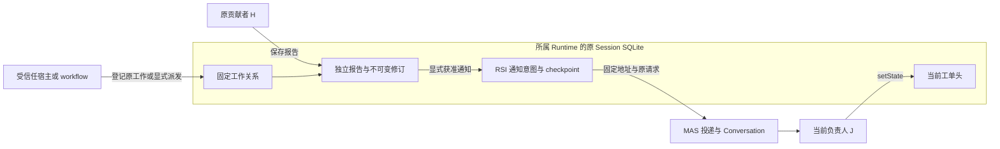

# RSI 原工作、独立报告与交接

RSI 保存通用协作事实。原工作说明谁基于哪份工单内容、在哪个 Conversation 工作；报告保存成果及修订；当前状态说明当前负责人如何推进。三者不互相冒充。

## 数据与职责



工单头、内容修订、事件和运行保留原寻址布局。原工作、报告头元数据、不可变报告正文版本及 actor/request 回执通过同一 RuntimeRecords 服务独立寻址。原工作和派发计划原子登记；一次报告操作原子写入报告头、正文版本、索引信号与原回执。通知是另一项操作，不与报告保存或 MAS 接纳假设跨服务原子事务。

## 被动 headless 示例

仓库内完成标准安装和构建后：

```powershell
npm ci
npm run build
$env:PAKKA_RSI_REPORTS_DIR = 'D:\LocalData\rsi-reports-example'
node packages/rsi/examples/work-reports.mjs
node packages/rsi/examples/work-reports.mjs
```

[示例](../../packages/rsi/examples/work-reports.mjs)登记 H 的原 Conversation，将工单转派 J 并修改当前正文，随后由 H 保存两份独立报告及一笔报告修订。H 读取原内容，不获得 J 的未来内容读权；报告不改变 J 的状态。第二次运行重新打开 `session.json` 指向的原 SQLite，通过相同请求查回原对象，不创建替代 Session 或重复成果。

示例不发送消息或运行模型；未安装 MAS、Memo、WebUI 也能运行。占位 provider 地址不承担演示推理。`session.json` 只保存原 Session 文件身份；业务内容、版本和回执留在原 SQLite。

## 原工作关系

`registerWork` 的新登记只允许 manager，将已批准的当前 handler、已有的精确 ConversationRef 和真实固定内容修订登记为原工作。新 `dispatch` 则把工作关系与原运行计划一起保存，并将 `workId` 放入固定派发消息。调用者不能通过自报 actor、contentRevision、runId 或伪造引用取得贡献资格。

- 普通转派不取消 H 的原生运行，也不改写 H 的原工作关系。
- `getWork({ id, workId })` 返回原关系及那份内容修订，不读取工单后来的正文。
- 贡献者、原工单作者和 manager 可读原工作；当前 handler 可读本工单的报告。有效 reader 可读自己既有原工作，但不能贡献。
- `setWorkContribution` 使用工作自身的 `expectedVersion`，显式停止未来贡献。它不删除旧成果，不取消原生执行，也不代替身份停用；role 为 null 或 actor.check 失败拒绝访问。
- 旧运行和 `reported` 历史保留为原事实。缺少可信原关系的旧 run 不能自动回填成获准工作。

## 保存、修订和状态

`report({ requestId, id, workId, text, links, results? })` 新增报告。输入没有工单 `expectedVersion` 或 state，也不能携带作者和内容修订自授权。不同报告可以并发追加，同一 actor/request 去重。

`reviseReport` 使用报告自身的 `expectedVersion`，保留旧正文版本。原报告作者 `actorId` 不因修订转移，`revisionActorId` 记录该版本实际作者；manager 修订不会被错误记成 H 的新发言。报告作者或 manager 仍须获得原工作的当前贡献授权。停用贡献与报告版本竞争在实际事务中判断。

`setState` 才修改当前状态，权限属于当前 handler 或 manager，并使用工单版本。保存或修订报告不推进工单 version/contentRevision/state，不自动成为结论，不关闭工单。是否评价、采用、接续或取消运行属于可替换 workflow。

`lookup(requestId)` 返回当前 actor 的原回执。提交后失去该对象读权返回 `unknown`，报告和原请求仍保留；恢复读权后核对原请求，不更换请求号重放。原贡献者降为有效 reader 仍可读取自己的旧工作和已提交回执，但不获得新的写权。登记或停止贡献的同一原请求重投也只查回原效果：仍需原对象读权，不要求重新取得该操作的写资格；新登记或新贡献授权修改仍须 manager。

## 摘要、版本与过程导航

`reports` 返回至多 32 条摘要，不装载报告全文。游标固定本次报告集合的流边界；后来新增的报告由刷新发现。摘要标明读取当时的最新报告版本，修订可在翻页期间更新摘要；需要不可变正文时携带摘要中的 reportId/version 调用 `readReport`。这不把整个列表声明为跨服务冻结快照。

`readReport({ id, reportId, version? })` 只读取一份正文；指定 version 固定旧版本。正文最多 12,000 UTF-16 units，8 条 links 和 8 条结果引用，完整 JSON 编码后不超过 180 KiB。累计工作、报告和修订数量不限制服务寿命。

报告和原运行携带精确 ConversationRef。宿主导航仍校验原 Session、对象身份和访问权；引用本身不授权过程正文或外部产物。普通读取、重新开库和过程预览不执行模型、不清锁、不解除恢复停机。新的跨 Session GUI 浏览及独立报告界面是插件消费工作，不能由引用存在推断已经实现。

## 可选 MAS 交接

只有已保存的固定报告版本可以通知。受信任宿主单独装配：

```ts
import { createMasReportNotifier } from "@pakka/rsi/mas";
const notices = await createMasReportNotifier({
	runtime,
	namespace: "rsi.report-notices",
	tickets: manager,
	routes: [{ handlerId: "J", target: originalJRef, client: approvedSender }],
	check: () => assertCurrentNotificationLease(),
});
const notice = await notices.notify({
	requestId: "report-R1-to-J",
	id: report.id,
	reportId: report.reportId,
	reportVersion: report.reportVersion,
	handlerId: "J",
});
// If uncertain, retain this request and query, without another send:
const original = await notices.reconcile("report-R1-to-J");
```

`report` 在此指保存报告取得的回执。handlerId 只选择宿主批准的路由，不是通信地址、actor 身份或 MAS 授权。MAS client 自身保留 principal/source/grants；RSI 使用已有公开发送和 lookup 能力，不改变 MAS 或 Board。

通知只带固定报告/工作/内容版本与原过程引用，不复制报告正文，也不向接收方授予额外读权。计划固定目标、消息和请求身份；独立 CAS 确认 `planned → dispatching` 的唯一执行资格。`accepted` 只证明原 MAS delivery 已被接纳，不等于 J 已阅读或工单已完成。

发送已开始但响应丢失或接收方查无记录，保持 `unknown`；重复 `notify` 与 `reconcile` 沿原路由和原消息 lookup，不盲目重发。离线、停机和 unknown 不删除报告。被动构建通知器或重开不派发，不创建替代成员；未确认通知仍列入宿主未完成工作核对。

## 消费边界

headless、原生 `ticket_*` 工具及 Backend/Client 命令共享以上服务。新 wire action 使用 kebab-case，原生工具使用 snake_case，例如 `set-state` 对应 `ticket_set_state`；TypeScript SDK 保留 `setState` 方法名。原 `report` 的状态副作用没有兼容暗路；旧调用方须明确选择独立报告或状态命令。

现有页面的状态操作已改为 `setState`。新的报告编辑/列表可视化及交接管线展示仍由 RSI 插件实现，不加入 WebUI 核心，不强制 Memo 或 MAS 装配。

契约入口：[RSI state](../state/rsi.md)、[API](../reference/RSI-API.md)、[领域需求](../requirements/RSI-WORK-REPORTS.md)。
