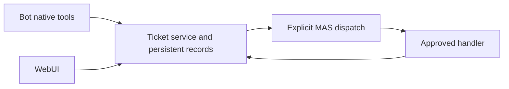

## Context

See proposal.md for the operator's requested scope. Work starts from fetched `origin/dev` at e7c938ef3b7c2005ef9db319bd84598c25ab8b23 in an isolated worktree. The original checkout's changes remain untouched. Current RuntimeStore uses SQLite-backed Durable documents and public CAS; MAS and WebUI expose controlled public integration surfaces.

## Goals / Non-Goals

The layer owns ticket collaboration records, scoped clients, native tools, MAS delivery linkage and a small working UI. Business discovery/research/build/review/deployment programs remain consumers. Memo is initialized only, with no adopted memory semantics. No native adapter or Dynamite change is planned.

## Decisions

- Put `@pakka/rsi` and `@pakka/memo` under packages. RSI separates the headless service/Agent exports from optional MAS and WebUI exports; Memo has an inert entry and scope documentation, as explicitly requested despite the usual rule against empty packages.
- Use one host-owned RuntimeStore namespace per ticket space. Serialize local mutations, use native CAS, validate every read and bound all capacities. This reuses the existing persistence/writer model instead of introducing another database writer. External CAS uncertainty is reported conservatively, not retried by error-string matching.
- Bind trusted stable actor ID, current role getter/check and optional Conversation source in closures. Model/browser payloads cannot supply authority. Authors edit their own content, handlers report on assigned tickets, managers assign/dispatch/manage. Mutation receipts are compact immutable records indexed by actor/request; reads return current ticket separately.
- Keep ticket version (all changes) and content revision distinct. Runs capture a content revision. Open/active/waiting/closed are generic collaboration states; workflow stages are comments/progress. Histories and result references are retained within explicit bounds.
- Configure a finite set of handlers at trusted composition, each with a stable ticket actor identity. The optional MAS dispatcher maps those handler IDs to approved references/clients. Dispatch persists a run before sending; result observation uses its original receipt. Pending/unknown deliveries are not silently resubmitted. Native completion is separate from ticket resolution.
- Use the existing public extension slots for a tickets page, bounded schemas, typed client and Backend service binding. Global product administrators manage the ticket space by default; other authenticated people receive submitter access and viewers retain read-only access to their own records. A host callback can override this current business-role mapping. App-scoped service access uses current human authentication; ticket visibility is enforced by the service, without inventing a Conversation target. The package never installs itself or grants ambient permissions.
- Preserve confirmed terminal MAS observations when stale queries arrive. Browser request keys first resolve the host operation; its operation ID is the ticket-service mutation identity, so lost responses can be reconciled without resubmission.
- Ship an executable optional composition using public exports. Deterministic tests cover real Runtime, MAS, native tools and browser. No paid model trial is needed to establish thin service behavior; business workflow model feasibility remains outside this slice.

## Risks / Trade-offs

- Bounded JSON coordinator storage can fill: expose capacity refusal; do not silently erase request receipts or claim unlimited retention.
- Cross-store ticket/MAS effects are not atomic: retain run and delivery identities and unknown state; recovery reads existing results rather than starting replacement work.
- Live references can change on reconfiguration: the host supplies approved current routing; old runs keep their original target/receipt identity.
- User content can contain links or hostile markup: render text safely; only allow explicit HTTP(S) links in the web view.
- GUI and adversarial subagent verification are not selected because the operator prohibited subagent review; the primary session performs deterministic runtime/browser checks and direct UI inspection.

## Migration Plan

This adds opt-in packages and services. Existing products keep their current assembly. Installation examples explicitly register tools, service and UI facets. Removing UI stops observation; removing the service prevents new calls while durable records remain in its owning storage. No existing store migration is required.
