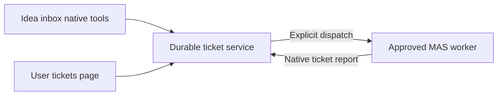

# @pakka/rsi

A persistent ticket service for Bots, people and workflows. Submission returns after saving the ticket; starting a handler is an explicit operation. The package includes native Agent tools, an optional MAS dispatcher and a WebUI tickets page. `@pakka/memo` is independent and currently has no functional semantics.

## Run the workbench example

From the monorepo root:

```sh
npm ci
npm run build
node packages/rsi/examples/workbench.mjs
```

Open the locally printed sign-in URL. **Tickets** supports creation, author edits, history, assignment, progress and results. Ticket CRUD needs no model request. The **Idea inbox** Conversation can use ticket tools; **Start work** dispatches an assigned ticket revision to the example's worker.

Agent execution requires an explicitly configured OpenAI-compatible provider. Set `PAKKA_ENDPOINT`, `PAKKA_MODEL` and `PAKKA_API_KEY` in the trusted launch environment. The example otherwise targets `http://127.0.0.1:45010/v1` with a local-only credential; it never reads a user's model settings. `PAKKA_RSI_DIR` selects storage, defaulting to `artifacts/rsi-workbench`; `PAKKA_RSI_PORT` selects the port, defaulting to an available local port. Ctrl+C closes the app; a normal restart reopens the exact SQLite file named in `session.json` without re-dispatching tickets.

The example installs no IM connector, filesystem tools, research/build pipeline or deployment automation. A production Bot supplies its own connector and processing workflow.



Completion means a handler has recorded a result and closed the ticket. MAS generation completion alone leaves it open or active. Ticket content/revisions, reports, original request receipts and run references are in RuntimeStore; transcripts and delivery receipts remain in native Runtime/MAS storage. No application call stack is restored. Reopen obtains fresh runtime authority and reuses the saved logical identities.

## Public surfaces

| Export               | Purpose                                                       |
| -------------------- | ------------------------------------------------------------- |
| `@pakka/rsi`         | `createTicketService`, DTOs, bound clients, `TicketError`     |
| `@pakka/rsi/agent`   | `createTicketTools`, current native invocation contribution   |
| `@pakka/rsi/mas`     | `createMasTicketDispatcher`, explicit approved routes         |
| `@pakka/rsi/backend` | `ticketExtensionService`, `rsiExtensionRoot`, Backend actions |
| `@pakka/rsi/client`  | Typed browser `ticketCall` and validated `readTicketResult`   |
| `@pakka/rsi/webui`   | The public `Tickets` Preact page                              |

The first three imports do not load WebUI or Preact. Backend/UI peers are optional and activated only by trusted composition.

```ts
const service = await createTicketService({ runtime, namespace: "ideas" });
const bot = service.connect({
	id: "im-bot",
	role: () => "submitter",
	check: () => assertCurrentBotLease(),
});
const receipt = await bot.submit({
	requestId: "im-message-123",
	title: "Shared agent filesystem",
	body: "Investigate workspace cost.",
	sources: ["https://example.org/message"],
});
const current = await bot.get(receipt.id);
await bot.edit({
	requestId: "im-message-123-edit-1",
	id: receipt.id,
	expectedVersion: current.ticket.version,
	title: current.ticket.title,
	body: "New observation.",
	sources: [],
});
```

`connect` is a trusted composition API, never a model/HTTP operation. Native tool resolvers must use `service.forInvocation({ actor, source }, scope)` so the runtime checks the exact Conversation and current invocation. The complete example demonstrates deferred runtime wiring.

Roles are `submitter`, `handler`, `manager`, and read-only `reader`. Authors see and edit their own tickets; assigned handlers see/report their work; managers manage the ticket space. Default WebUI mapping gives global product administrators the manager role, viewers read-only access to their existing authored records, and other authenticated people submitter access. `roleForPerson` can supply an explicit current business role. Browser/model payloads cannot choose their identity.

Use `get`/`list` for current state and `lookup(requestId)` for an original receipt. Content edits require the observed version. After an unknown write, retain its request ID and reconcile before creating another request. The UI retains a pending request ID in tab session storage; it does not save ticket drafts there. Known conflicts preserve the open draft.

## Limits and current recovery

One service instance owns a namespace within one Runtime. Defaults are 256 tickets, 4,096 mutation receipts and 4 MiB total JSON; each ticket is limited to 192 KiB so it remains readable through the WebUI transport. A ticket has at most 128 content revisions, 256 events and 64 runs. Inputs are bounded: 200-character title, 12,000-character body/report, and eight references of at most 2,048 characters. Capacity refusal never silently deletes history.

MAS routes use exact original target/source identities. Pending or unknown runs block replacement dispatch; normal reopen and repeated requests do not resend. When delivery occurred but no receipt could be retained, this first layer preserves the unknown run for host-side reconciliation; it does not guess a rollback or provide an automatic recovery workflow. Disabling/removing the UI leaves tickets and accepted work intact.

The package is private and opt-in. The example and installed consumer are exercised with a local deterministic provider; this establishes protocol, storage and permission behavior, not research quality or real-model task capability.
