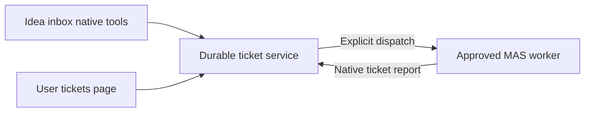

# @pakka/rsi

A persistent ticket service for Bots, people and workflows. Submission returns after saving the ticket; starting a handler is an explicit operation. The package includes native Agent tools, independent original-work reports, an optional MAS dispatcher/report notifier and a WebUI tickets page. Memo remains independent; no Memo or WebUI installation is required for headless report use.

## Run the passive report example

```powershell
npm ci
npm run build
node packages/rsi/examples/work-reports.mjs
node packages/rsi/examples/work-reports.mjs
```

The [headless example](examples/work-reports.mjs) registers H’s exact original Conversation/revision, transfers to J, saves two H reports and a correction without changing J’s state, and reopens the original SQLite on the second run. No model request, MAS, Memo or WebUI is needed. Details and optional save-then-notify composition: [work reports guide](../../docs/guides/RSI-WORK-REPORTS.md).

## Run the workbench example

From the monorepo root:

```sh
npm ci
npm run build
node packages/rsi/examples/workbench.mjs
```

Open the locally printed sign-in URL. **Tickets** supports creation, author edits, history, assignment, progress and results. Ticket CRUD needs no model request. The **Idea inbox** Conversation can use ticket tools; **Start work** dispatches an assigned ticket revision to the example's worker.

Agent execution requires an explicitly configured OpenAI-compatible provider. Set `PAKKA_ENDPOINT`, `PAKKA_MODEL` and `PAKKA_API_KEY` in the trusted launch environment. The example otherwise targets `http://127.0.0.1:45010/v1` with a local-only credential; it never reads a user's model settings. `PAKKA_RSI_DIR` selects storage, defaulting to `artifacts/rsi-workbench`; `PAKKA_RSI_PORT` selects the port, defaulting to an available local port. Ctrl+C closes the app; a normal restart reopens the exact SQLite file named in `session.json` without re-dispatching tickets.

The example installs no IM connector, filesystem tools, research/build pipeline or deployment automation. A production Bot supplies its own connector and processing workflow.



Saving a report does not close or otherwise update a ticket. Closing requires a separate authorized `setState` decision; MAS generation completion alone also leaves its business state unchanged. The existing page uses the explicit state command; standalone report visualizations and cross-Session process navigation remain plugin-consumption work. Ticket content/revisions, reports, original request receipts and run references are individually stored through RuntimeRecords in the owning Session SQLite; transcripts and delivery receipts remain in native Runtime/MAS storage. No application call stack is restored. Reopen obtains fresh runtime authority and reuses the saved logical identities.

## Public surfaces

| Export               | Purpose                                                                 |
| -------------------- | ----------------------------------------------------------------------- |
| `@pakka/rsi`         | `createTicketService`, DTOs, bound clients, `TicketError`               |
| `@pakka/rsi/agent`   | `createTicketTools`, current native invocation contribution             |
| `@pakka/rsi/mas`     | `createMasTicketDispatcher`, `createMasReportNotifier`, approved routes |
| `@pakka/rsi/backend` | `ticketExtensionService`, `rsiExtensionRoot`, Backend actions           |
| `@pakka/rsi/client`  | Typed browser `ticketCall` and validated `readTicketResult`             |
| `@pakka/rsi/webui`   | The public `Tickets` Preact page                                        |

The first three imports do not load WebUI or Preact. Backend/UI peers are optional and activated only by trusted composition.

```ts
const service = await createTicketService({ runtime, namespace: "ideas" });
const bot = service.connect({
	id: "im-bot",
	role: () => "submitter",
	check: () => assertCurrentBotLease(),
});
const receipt = await bot.submit({
	requestId: "im-message-123",
	title: "Shared agent filesystem",
	body: "Investigate workspace cost.",
	sources: ["https://example.org/message"],
});
const current = await bot.get(receipt.id);
await bot.edit({
	requestId: "im-message-123-edit-1",
	id: receipt.id,
	expectedVersion: current.ticket.version,
	title: current.ticket.title,
	body: "New observation.",
	sources: [],
});
```

`connect` is a trusted composition API, never a model/HTTP operation. Native tool resolvers must use `service.forInvocation({ actor, source }, scope)` so the runtime checks the exact Conversation and current invocation. The complete example demonstrates deferred runtime wiring.

Roles are `submitter`, `handler`, `manager`, and read-only `reader`. Authors see and edit their own tickets; current handlers manage current state; original contributors can report trusted allowed work after reassignment, without reading future ticket content. Managers manage the space. A report retains its original `actorId` and each fixed revision records its actual `revisionActorId`. Default WebUI mapping gives global product administrators the manager role, viewers read-only access to their existing authored records, and other authenticated people submitter access. `roleForPerson` can supply an explicit current business role. Browser/model payloads cannot choose their identity.

Use `get`/`list` for bounded current state, `history` with the returned cursors for earlier revisions/events/runs, `observe` for an authority-scoped change token and `lookup(requestId)` for an original receipt. Content edits require the observed version. After an unknown write, retain its request ID and reconcile before creating another request. The UI retains a pending request ID in tab session storage; it does not save ticket drafts there. Known conflicts preserve the open draft.

## Limits and current recovery

A namespace belongs to one Session and its exclusive writer. Independent service instances use record versions and original request receipts. Cumulative tickets, revisions, events, runs and receipts do not define the service lifetime. Inputs, transactions, pages and unfinished work are bounded: title 200 and body/report 12,000 UTF-16 units; eight links of at most 2,048 units; detail below 256 KiB; each history window at most 32 items. The UI replaces its current history window when paging. Result references can carry URI, version, SHA-256 and description, optionally linked to one of the ticket’s runs.

MAS routes use exact original target/source identities and a fixed revision/payload hash. A durable planned → dispatching checkpoint precedes send. `refresh` queries the original receipt or request without admission; `recover` explicitly continues a confirmed unsent plan under current manager authority. Missing delivery after a possible send remains unknown because admission hooks may already have effects. Generation completion does not close a ticket. Optional report notifications save their own stable checkpoint and reconcile uncertain sends by original delivery lookup; the report survives independently.

For legacy schema 1 data, stop the product, take a consistent cold backup, then reopen the original Session and explicitly use `migrateLegacy: true` with the original `maxBytes`. The migration freezes the old namespace, retains its source, resumes deterministic committed batches after interruption, and publishes only a complete new layout. Ordinary reopen does not dispatch work. Backups restored through product maintenance remain held until explicit reconciliation.

The package is private and opt-in. The example and installed consumer are exercised with a local deterministic provider; this establishes protocol, storage and permission behavior, not research quality or real-model task capability.
